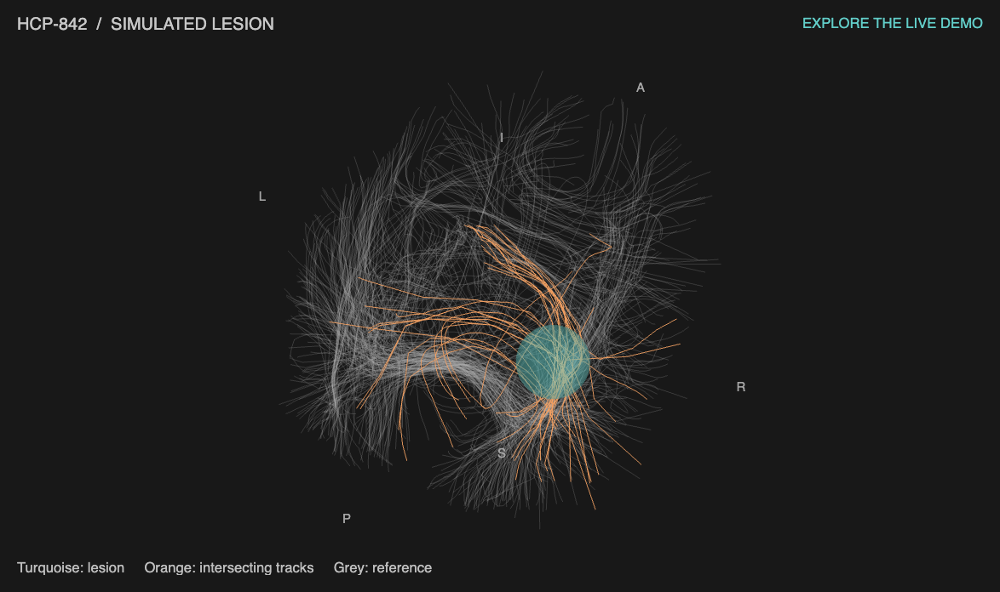

<div align="center">

# Tract Viewer

**One lesion mask → an interactive tract view.**

[**Try it online ↗**](https://jvohryzek.github.io/tract-viewer/) · [Download](https://github.com/jvohryzek/tract-viewer/archive/refs/heads/main.zip)

</div>

[](https://jvohryzek.github.io/tract-viewer/)

## Setup

Requires **MATLAB with Image Processing Toolbox** (tested in R2026a).
You supply the lesion masks; **600 reference tracks are included**.

1. Create a project folder, for example `lesion_project`, with a `lesions` subfolder.
   Put one mask per subject there, using the format below.
2. [Download the toolbox ZIP](https://github.com/jvohryzek/tract-viewer/archive/refs/heads/main.zip)
   and unzip it into `lesion_project`:

   ```text
   lesion_project/
   ├── lesions/
   │   ├── subject_01.nii.gz
   │   └── subject_02.nii.gz
   └── tract-viewer-main/
       └── ...toolbox files
   ```

3. In MATLAB, set **Current Folder** to `lesion_project`, then run:

   ```matlab
   addpath("tract-viewer-main");
   plot_lesions("lesions", "results");
   ```

4. Open `results/subject_01.html` and `results/subject_02.html` in your browser
   for the **individual interactive views**. The **group figure** opens in
   MATLAB and is saved as `results/all_subjects.png` and `results/all_subjects.pdf`.

Subjects follow alphabetical filename order, with the same axial scale in each
group panel. Drag the HTML views to rotate; scroll to zoom.

For an **individual PNG/PDF** too, run one mask separately:

```matlab
plot_lesions("lesions/subject_01.nii.gz", "results/subject_01");
```

Its single-subject figure is saved as `all_subjects.png` / `.pdf` in that subfolder.

To try the bundled simulated lesion, run `example_tracts` and open
`tract-viewer-main/example.html`, or [try it online](https://jvohryzek.github.io/tract-viewer/).

## Mask format

| Mask requirement | What to provide |
| :--- | :--- |
| File | One **3-D NIfTI** volume, `.nii` or `.nii.gz` (a singleton fourth dimension is accepted) |
| Values | **0** = background, **1** = lesion; at least one lesion voxel |
| Space | Already registered to **FSL MNI152 / MNI152NLin6Asym** space |
| Dimensions | Any 3-D grid, e.g. `182 × 218 × 182` at 1 mm or `91 × 109 × 91` at 2 mm |
| Orientation | A valid NIfTI **sform or qform**, with spatial units in **millimetres**; axis order and flips are read from the header |

No manual flipping or mesh preparation is needed. Native-space masks must be
registered beforehand. Orange tracks show intersections in the display sample;
this is a visualisation, not a full disconnection analysis.

## Where the tracks come from

The **HCP-842 atlas** ([Yeh et al., 2018](https://doi.org/10.1016/j.neuroimage.2018.05.027))
was accessed through the **[Lesion Quantification Toolkit (LQT)](https://github.com/jcgriffis/lesion_quantification_toolkit)**:
**[toolbox paper](https://doi.org/10.1016/j.nicl.2021.102639)** · **[original tract folder](https://github.com/jcgriffis/lesion_quantification_toolkit/tree/050bc257d686d7e7cba28262429e583bf5be7454/Support_Tools/Tractography_Atlas/HCP_842)**.

Code: [MIT](LICENSE). Atlas data: [CC BY-SA 4.0](https://creativecommons.org/licenses/by-sa/4.0/)
and HCP terms. [Full attribution and data preparation](data/README.md).
